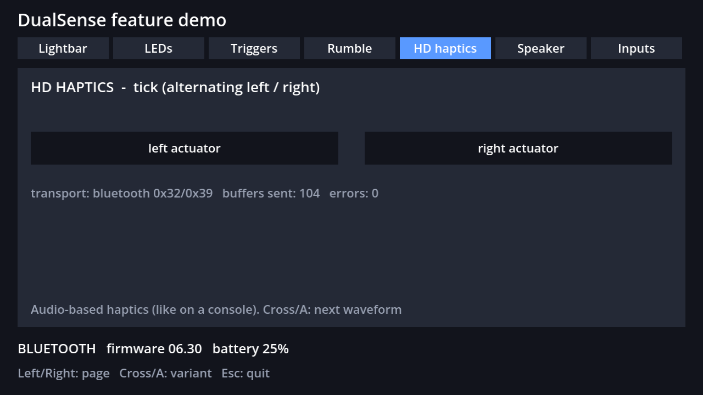
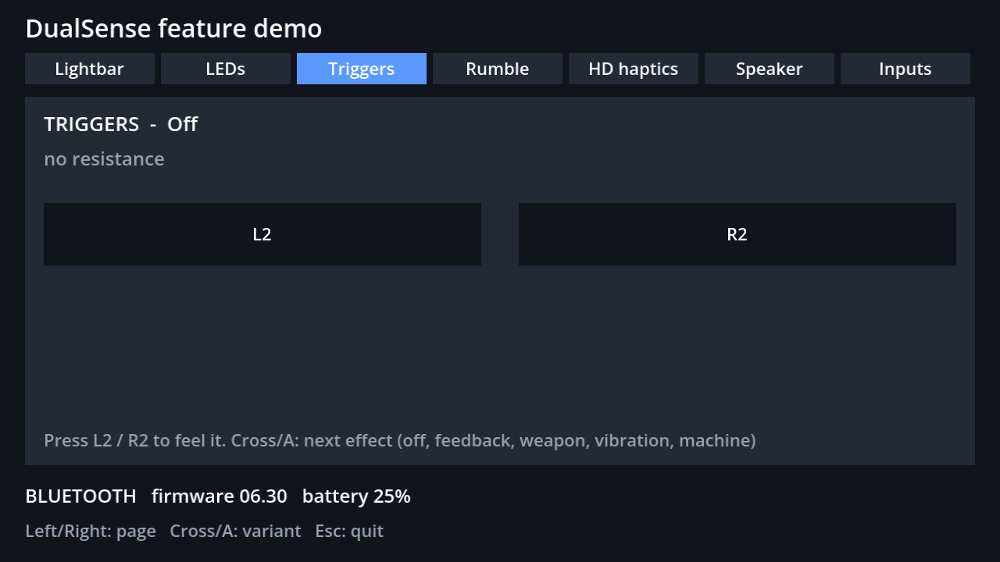
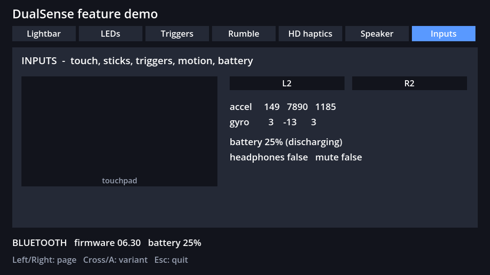

# godot-dualsense-native

Full **DualSense** (PS5 controller) support for **Godot 4** through a native GDExtension: every
feature a console game can use, over **USB and Bluetooth**, with no third-party software running.



| Feature | USB | Bluetooth |
| -- | -- | -- |
| Buttons, sticks, triggers, touchpad (2 fingers), gyro/accelerometer, battery, headphone/mic jack, mute button | ✅ | ✅ |
| Adaptive triggers (feedback, weapon, vibration, machine) | ✅ | ✅ |
| Lightbar, player LEDs, mute LED | ✅ | ✅ |
| Classic rumble (v1/v2 chosen from the firmware) | ✅ | ✅ |
| **HD haptics** (audio-based, left/right actuators) | ✅ Windows | ✅ |
| **Built-in speaker** | ✅ Windows | ✅ (Opus, like the console) |
| Speaker/headphone routing | ✅ | ✅ |

Godot's own gamepad API keeps working for buttons and axes; this extension adds everything else by
talking to the controller over HID ([hidapi](https://github.com/libusb/hidapi)).

> Status: working and measured on a DualSense with firmware 06.30 (Windows 11, USB and Bluetooth).
> Other firmware versions, the DualSense Edge and Linux hardware are expected to work but are less
> tested — reports are welcome. Not affiliated with Sony.

## Quick start

1. Build the extension (Docker, everything pinned by SHA-256):
   ```bash
   ./build.sh            # linux + windows -> example/addons/dualsense/bin/
   ```
   Prebuilt binaries for Windows x86_64 and Linux x86_64 are committed in the same folder.
2. Open `example/` in Godot 4.7 and run it, or copy `example/addons/dualsense` and
   `example/core/DualSensePad.gd` into your project.
3. Run the demo: the controller must be connected by USB or paired over Bluetooth. Close Steam
   (Steam Input) and similar tools while testing so they don't fight over the controller.

```gdscript
var pad := preload("res://core/DualSensePad.gd").new()   # finds/opens/reopens the controller
add_child(pad)

func _process(_delta):
    if not pad.is_open():
        return
    var ds: RefCounted = pad.device
    ds.set_lightbar(Color.ORANGE)
    ds.set_player_leds(0b00100, 0)
    ds.set_trigger_effect(false, DualSense.trigger_weapon(3, 6, 8))     # L2: resistance + click
    ds.set_trigger_effect(true, DualSense.trigger_vibration(1, 8, 15))  # R2: buzzing trigger
    ds.send_output()

func explode():
    pad.device.haptics_play(my_haptic_frames_3khz)   # PackedVector2Array, x = left, y = right
    pad.device.speaker_play(my_sound_frames_48khz)   # PackedVector2Array, stereo 48 kHz
```

Full API: see `native/src/dualsense.h` (every method is bound to GDScript) and
[docs/PROTOCOL.md](docs/PROTOCOL.md).

## Example project

| Scene | How to open | What it does |
| -- | -- | -- |
| Feature demo | default | One page per feature (lightbar, LEDs, triggers, rumble, HD haptics, speaker, inputs) |
| Controller test | `--controller-test` | Raw readout from Godot and from the extension (firmware, battery, touch...) |
| Self-test | `--selftest --selftest-out=result.json` | Measures vibration with the controller's own accelerometer (no person needed) |




The **self-test** is how this project was debugged: with the controller resting on a table, the
IMU "feels" each output. Measured on firmware 06.30: rest ≈ 2 mg, classic rumble ≈ 770 mg,
HD haptics at 60 Hz ≈ 1300 mg (Bluetooth and USB).

## Building

* `./build.sh [linux|windows|all]` builds a Docker toolchain (Debian, godot-cpp 10.0.0 compiled
  against the Godot 4.7.2 API dump, hidapi 0.15.0, libopus 1.6.1, gcc and mingw-w64) and compiles
  the extension. The Windows DLL is fully static (it only imports system DLLs).
* Tests (no hardware): `godot --headless --path example --script ../tests/run_tests.gd`
* Godot 4.7.2 note: the first headless `--import` of a project with a new GDExtension may crash
  on exit (godot#123511); running it a second time works.

## How it works (short)

* **Inputs/outputs**: HID reports 0x01/0x31 (input) and 0x02/0x31 (output), as in the Linux
  `hid-playstation` driver and SDL. Bluetooth reports carry a CRC32 with a seed byte.
* **HD haptics**: USB = channels 3–4 of the controller's 4-channel USB audio device (WASAPI);
  Bluetooth = report 0x32 with 8-bit PCM at 3 kHz.
* **Speaker**: USB = channels 1–2 of the USB audio device; Bluetooth = report 0x39 every 20 ms with
  two Opus frames (48 kHz, 10 ms, 160 kbit/s CBR) plus two haptic blocks.
* Rumble emulation must be **off** while HD haptics are used, otherwise the actuators leave
  audio-haptics mode.

Details, byte layouts and measurements: [docs/PROTOCOL.md](docs/PROTOCOL.md).

## Credits and sources

This project stands on public research by others — thank you:

* **SAxense** by Sdore — first public DualSense Bluetooth haptics research (MPL-2.0):
  https://apps.sdore.me/SAxense · https://github.com/egormanga/SAxense
* **DS5Dongle** and **dualsense-bt-haptics** by awalol (MIT) — Bluetooth speaker (0x39) and
  Windows haptics details: https://github.com/awalol/DS5Dongle · https://github.com/awalol/dualsense-bt-haptics
* **Linux `hid-playstation`** driver — input/output report layouts, audio routing:
  https://github.com/torvalds/linux/blob/master/drivers/hid/hid-playstation.c
* **SDL** `SDL_hidapi_ps5.c` — effects and rumble details: https://github.com/libsdl-org/SDL
* **Nielk1** "TriggerEffectGenerator" (MIT) — adaptive trigger encoding:
  https://gist.github.com/Nielk1/6d54cc2c00d2201ccb8c2720ad7538db
* **chiaki-ng** — haptics PCM format hints: https://github.com/streetpea/chiaki-ng
* Libraries: [godot-cpp](https://github.com/godotengine/godot-cpp),
  [hidapi](https://github.com/libusb/hidapi), [libopus](https://opus-codec.org) — see
  [THIRD_PARTY.md](THIRD_PARTY.md).

No code was copied from the projects above; the formats were reimplemented from their public
descriptions and sources. No proprietary software was decompiled.

## License

MIT — see [LICENSE](LICENSE). "PlayStation", "DualSense" and "PS5" are trademarks of Sony
Interactive Entertainment Inc. This project is not affiliated with or endorsed by Sony.

---

## Resumo em português

Suporte completo ao **DualSense** no **Godot 4** por uma GDExtension nativa: botões, touchpad,
sensores, gatilhos adaptativos, lightbar, LEDs, vibração clássica, **vibração HD** e **alto-falante**,
pelo **cabo USB e pelo Bluetooth**, sem nenhum programa de terceiros rodando.

* Compilar: `./build.sh` (Docker). Binários prontos para Windows e Linux já estão em
  `example/addons/dualsense/bin/`.
* Testar: abra `example/` no Godot 4.7, ou rode o executável exportado. Feche a Steam durante os
  testes.
* Autoteste: `--selftest` mede a vibração pelo acelerômetro do próprio controle.
* Testado no DualSense com firmware 06.30, no Windows 11, por USB e Bluetooth. Relatos de outros
  firmwares e do Linux são bem-vindos.
* Créditos às pesquisas públicas acima (SAxense, DS5Dongle, driver Linux, SDL, Nielk1). Licença MIT.
